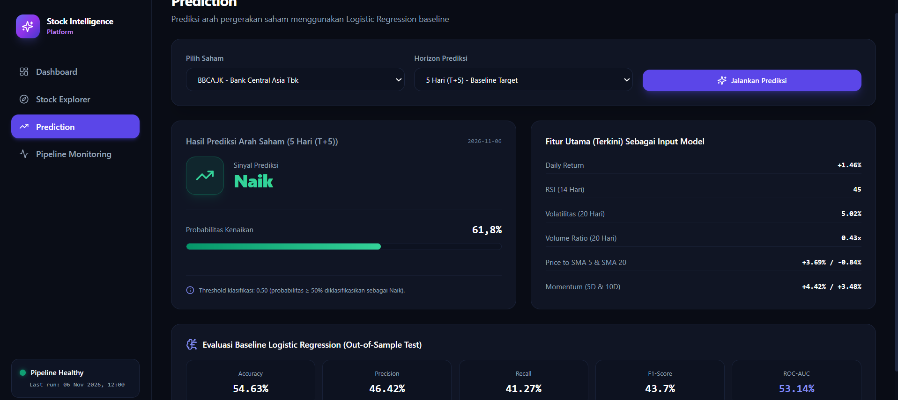
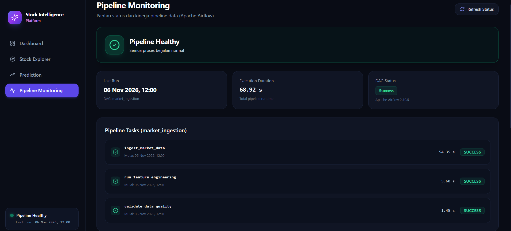

# Stock Intelligence Platform



Platform pengolahan dan analisis data pasar saham Indonesia berbasis Data Engineering. Proyek ini dibuat untuk menerapkan proses pengumpulan data, orkestrasi pipeline, transformasi data, validasi kualitas data, penyimpanan, hingga penyajian data melalui REST API dan web dashboard.

Fokus utama proyek ini adalah membangun pipeline Data Engineering yang terstruktur dan terotomatisasi, mulai dari data mentah hingga menjadi data yang siap digunakan untuk analisis dan aplikasi downstream.

---

## Gambaran Umum Proyek

Stock Intelligence Platform merupakan platform yang dirancang untuk mengotomatisasi proses pengambilan, pengolahan, validasi, dan penyimpanan data pasar saham Indonesia.

Proyek ini mengimplementasikan alur kerja Data Engineering secara end-to-end, dengan fokus pada pengelolaan data dan infrastruktur pipeline, bukan pada pengembangan model Machine Learning sebagai tujuan utama.

### Tujuan Proyek

- Mengotomatisasi pengambilan data pasar saham.
- Mengelola dan menjadwalkan pipeline menggunakan Apache Airflow.
- Melakukan transformasi data mentah menjadi data yang siap dianalisis.
- Menerapkan validasi kualitas data.
- Menyimpan data terstruktur menggunakan PostgreSQL.
- Menyediakan data melalui REST API.
- Menampilkan hasil pengolahan data melalui web dashboard.
- Mengemas seluruh layanan menggunakan Docker dan Docker Compose.

---

## Arsitektur Sistem

Platform ini terdiri dari beberapa komponen yang saling terintegrasi.

```text
                SUMBER DATA SAHAM
                   Yahoo Finance
                        |
                        v
                 DATA INGESTION
                     Python
                        |
                        v
               DATA TRANSFORMATION
               Feature Engineering
                        |
                        v
                 DATA VALIDATION
                  Data Quality
                        |
                        v
                   POSTGRESQL
                        |
              +---------+---------+
              |                   |
              v                   v
           FASTAPI             ML MODEL
              |              Logistic Regression
              |                   |
              +---------+---------+
                        |
                        v
                  NEXT.JS WEB
                   DASHBOARD
```

**Orkestrasi Pipeline:**

Apache Airflow bertugas mengatur dan menjadwalkan proses pipeline, mulai dari pengambilan data, transformasi, hingga validasi kualitas data.

---

## Alur Kerja Data Engineering

### 1. Data Ingestion

Proses pengambilan data dilakukan menggunakan Python dengan sumber data dari Yahoo Finance.

Sistem mengambil data historis dari sejumlah saham yang terdaftar di Bursa Efek Indonesia.

Data yang dikumpulkan meliputi:

- Open Price
- High Price
- Low Price
- Close Price
- Adjusted Close Price
- Trading Volume

Modul ingestion bertanggung jawab mengambil dan mempersiapkan data mentah sebelum diproses lebih lanjut.

### 2. Data Orchestration

Apache Airflow digunakan untuk mengatur dan mengotomatisasi seluruh alur pipeline.

Proyek ini memiliki DAG bernama `market_ingestion` yang mengelola beberapa tahapan proses:

1. Market Data Ingestion
2. Feature Engineering
3. Data Quality Validation

**Jadwal Pipeline:**

- Frekuensi: Senin – Jumat
- Waktu eksekusi: 19:00 WIB
- Zona waktu: Asia/Jakarta

Apache Airflow juga menyediakan monitoring untuk melihat status eksekusi task dan riwayat pipeline.

### 3. Data Transformation

Data mentah yang diperoleh dari proses ingestion kemudian diolah menggunakan Python.

Tahapan ini mencakup Feature Engineering, yaitu proses pembentukan fitur atau indikator turunan dari data historis saham.

Tujuannya adalah menghasilkan struktur data yang lebih siap digunakan untuk kebutuhan analisis dan proses lanjutan.

### 4. Data Quality

Validasi kualitas data dilakukan untuk memastikan data hasil pemrosesan memenuhi sejumlah kriteria kualitas dasar.

Tahapan ini membantu mengidentifikasi potensi masalah pada data sebelum digunakan oleh proses downstream.

Penerapan Data Quality menjadi bagian penting untuk menjaga konsistensi dan keandalan data dalam pipeline.

### 5. Data Storage

PostgreSQL digunakan sebagai database utama untuk menyimpan data hasil ingestion dan pemrosesan.

Beberapa tabel utama yang digunakan:

| Tabel | Keterangan |
|---|---|
| `stock_prices` | Menyimpan data historis harga saham |
| `stock_features` | Menyimpan hasil feature engineering |
| `stock_labels` | Menyimpan label untuk kebutuhan training model |
| `model_evaluations` | Menyimpan hasil evaluasi model Machine Learning |

### 6. Data Serving

FastAPI digunakan untuk menyediakan REST API yang menghubungkan database dengan aplikasi frontend.

API bertugas mengambil dan menyajikan data yang telah diproses agar dapat digunakan oleh aplikasi lain.

Dengan pemisahan ini, proses pengolahan data, penyimpanan, dan penyajian data memiliki tanggung jawab masing-masing.

---

## Machine Learning

Proyek ini juga memiliki komponen Machine Learning menggunakan algoritma **Logistic Regression** sebagai model baseline untuk klasifikasi pergerakan saham.

Namun, Machine Learning bukan fokus utama dalam pengembangan proyek ini.

Prioritas utama masih berada pada pembangunan pipeline Data Engineering, mulai dari ingestion, orchestration, transformation, data quality, hingga data serving.

Model yang digunakan saat ini masih berada pada tahap baseline dan belum melalui proses optimasi secara mendalam, seperti:

- Hyperparameter tuning.
- Eksperimen pemilihan fitur.
- Perbandingan berbagai algoritma.
- Optimasi model secara menyeluruh.

Oleh karena itu, performa dan akurasi model saat ini masih terbatas dan belum optimal.

Komponen Machine Learning lebih ditujukan untuk menunjukkan bagaimana data hasil pipeline dapat dimanfaatkan oleh proses downstream, bukan sebagai sistem prediksi saham yang siap digunakan untuk pengambilan keputusan investasi.

---

## Aplikasi Web Dashboard

Untuk menyajikan hasil pengolahan data, proyek ini dilengkapi aplikasi web menggunakan Next.js dan TypeScript.

Frontend berkomunikasi dengan backend FastAPI untuk mengambil data dari database dan menampilkannya dalam bentuk dashboard yang lebih mudah dipahami.

### Fitur Utama

| Halaman | Fungsi |
|---|---|
| Dashboard | Menampilkan ringkasan informasi dan kondisi pasar saham |
| Stock Explorer | Menjelajahi dan memfilter data saham |
| Stock Detail | Menampilkan informasi dan histori saham tertentu |
| Prediction | Menampilkan hasil prediksi dari model baseline |
| Pipeline Monitoring | Memantau status dan aktivitas pipeline |

Aplikasi web berperan sebagai lapisan penyajian data (*data consumption layer*) dari keseluruhan platform.

---

## Teknologi yang Digunakan

| Kategori | Teknologi |
|---|---|
| Bahasa Pemrograman | Python |
| Data Source | Yahoo Finance |
| Data Ingestion | Python |
| Workflow Orchestration | Apache Airflow |
| Data Transformation | Pandas |
| Data Quality | Python |
| Database | PostgreSQL |
| Backend API | FastAPI |
| Frontend | Next.js, TypeScript |
| Machine Learning | Scikit-learn |
| Algoritma ML | Logistic Regression |
| Containerization | Docker |
| Container Management | Docker Compose |
| Version Control | Git, GitHub |

---

## Struktur Direktori

```text
stock-intelligence-platform/
│
├── airflow/
│   └── dags/
│       └── market_ingestion.py
│
├── backend/
│   ├── app/
│   │   ├── api/
│   │   ├── core/
│   │   ├── repositories/
│   │   ├── schemas/
│   │   ├── services/
│   │   └── main.py
│   ├── Dockerfile
│   └── requirements.txt
│
├── database/
│   └── init/
│       ├── 01-create-databases.sh
│       └── 02-create-tables.sql
│
├── frontend/
│   ├── src/
│   │   ├── app/
│   │   ├── components/
│   │   ├── lib/
│   │   └── types/
│   ├── Dockerfile
│   └── package.json
│
├── src/
│   ├── database/
│   ├── features/
│   ├── ingestion/
│   ├── ml/
│   │   └── models/
│   ├── quality/
│   └── utils/
│
├── docker-compose.yml
├── Dockerfile
├── requirements.txt
├── .env.example
└── README.md
```

---

## Menjalankan Proyek Secara Lokal

### Prasyarat

Pastikan perangkat sudah memiliki:

- Docker
- Docker Compose
- Git

### 1. Clone Repository

```bash
git clone https://github.com/irfanwdtr/data_engineer.git
```

### 2. Masuk ke Direktori Proyek

```bash
cd data_engineer/airflow/stock-intelligence-platform
```

### 3. Konfigurasi Environment

Buat file `.env` berdasarkan konfigurasi contoh:

```bash
cp .env.example .env
```

Sesuaikan nilai environment variable dengan konfigurasi lokal.

### 4. Jalankan Seluruh Service

```bash
docker compose up -d --build
```

### 5. Periksa Status Container

```bash
docker compose ps
```

### 6. Akses Aplikasi

Setiap layanan dapat diakses melalui port yang telah dikonfigurasi pada `docker-compose.yml`.

Layanan utama:

- Frontend: Web Dashboard Next.js
- Backend: REST API FastAPI
- Airflow: Interface orkestrasi pipeline
- PostgreSQL: Database utama

---

## Deployment

Aplikasi dikemas menggunakan Docker dan Docker Compose sehingga setiap service dapat dijalankan dalam lingkungan yang konsisten.

Platform ini direncanakan untuk dijalankan pada server Linux berbasis cloud, seperti **AWS EC2**.

Gambaran proses deployment:

1. Menyiapkan instance Ubuntu pada AWS EC2.
2. Menginstal Docker dan Docker Compose.
3. Mengambil source code dari GitHub.
4. Mengatur environment variable pada server.
5. Melakukan build dan menjalankan container.
6. Mengatur akses jaringan melalui AWS Security Group.
7. Mengakses aplikasi melalui alamat server dan port yang telah dikonfigurasi.

Dalam arsitektur deployment tersebut:

- Next.js menangani tampilan aplikasi.
- FastAPI menangani permintaan data.
- PostgreSQL menyimpan data.
- Apache Airflow menjalankan dan mengatur pipeline.

Saat ini proyek menggunakan Docker Compose untuk lingkungan pengembangan. Penguatan konfigurasi production, CI/CD, dan infrastruktur cloud masih menjadi bagian dari pengembangan selanjutnya.

---

## Keterbatasan Proyek

Beberapa bagian masih dapat dikembangkan lebih lanjut:

- Model Logistic Regression belum melalui optimasi secara mendalam.
- Performa prediksi Machine Learning masih terbatas.
- Pipeline bergantung pada ketersediaan data dari Yahoo Finance.
- Scheduler Airflow pada lingkungan lokal hanya berjalan ketika service dan perangkat host aktif.
- Implementasi production deployment dan otomatisasi CI/CD masih perlu dikembangkan.

Keterbatasan tersebut menjadi peluang untuk pengembangan sistem pada tahap berikutnya.

---

## Rencana Pengembangan

Beberapa pengembangan yang dapat dilakukan selanjutnya:

- Implementasi CI/CD menggunakan GitHub Actions.
- Deployment platform ke AWS EC2.
- Pengembangan monitoring dan alerting pipeline.
- Penambahan validasi Data Quality yang lebih komprehensif.
- Optimasi query dan indexing PostgreSQL.
- Pengembangan mekanisme error handling dan retry pada pipeline.
- Implementasi automated testing.
- Penambahan sumber data dan cakupan saham.
- Eksperimen dan pengembangan model Machine Learning lebih lanjut.

---

## Tentang Pengembang

**Irfan Widiantoro**

Fokus Pengembangan:
- Data Engineering
- Data Pipeline Development
- Workflow Orchestration
- Database Management
- Cloud & Infrastructure

GitHub: [@irfanwdtr](https://github.com/irfanwdtr)

---

*Proyek ini merupakan implementasi pembelajaran dan praktik end-to-end Data Engineering, yang mencakup proses pengumpulan, pengolahan, orkestrasi, validasi, penyimpanan, dan penyajian data hingga dapat dimanfaatkan oleh aplikasi downstream.*
