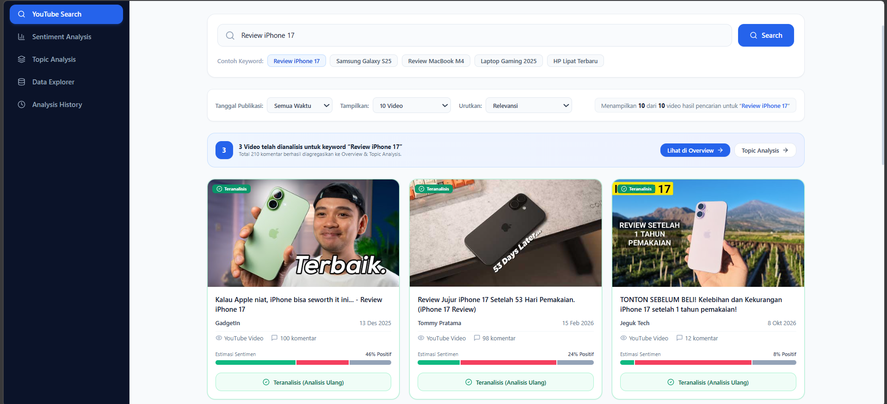
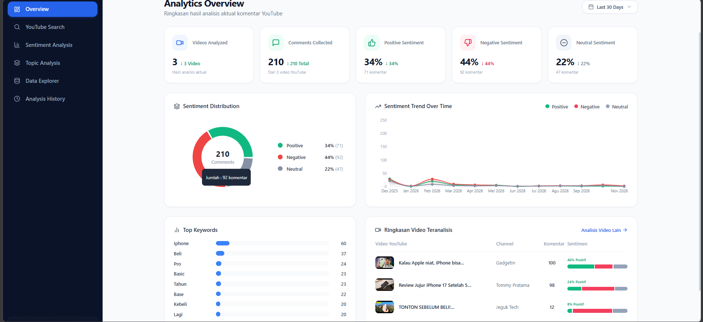
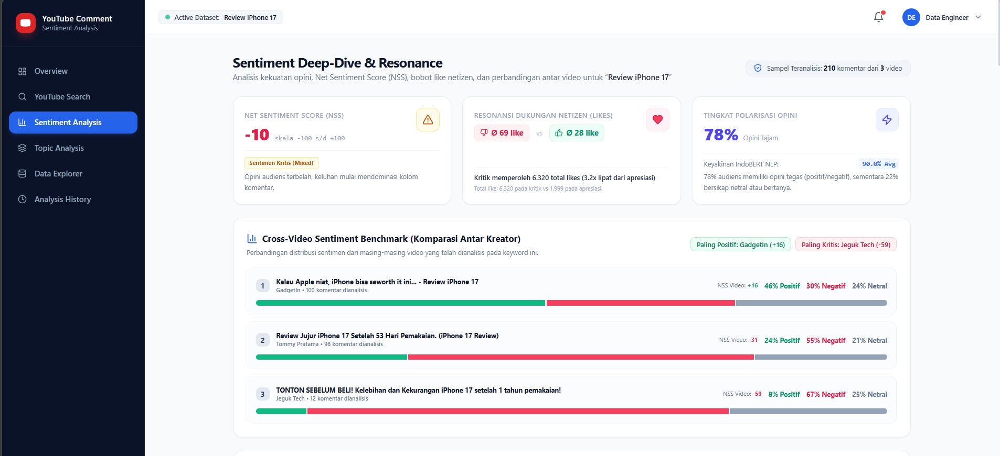
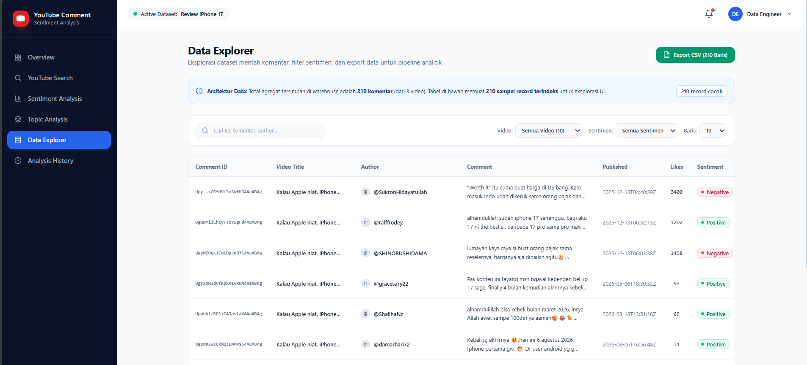

# YouTube Comment Sentiment Analysis

Platform analisis sentimen komentar YouTube berbasis *Data Engineering* dan *Machine Learning* yang dirancang untuk mengumpulkan, mengolah, menganalisis, dan memvisualisasikan opini pengguna berdasarkan kata kunci tertentu.

## Gambaran Umum Proyek

YouTube Comment Sentiment Analysis merupakan proyek pengolahan data yang bertujuan untuk mendapatkan insight dari komentar publik di YouTube.

Pengguna dapat memasukkan kata kunci untuk mencari video YouTube yang relevan. Sistem kemudian melakukan pengambilan komentar, pembersihan data, klasifikasi sentimen, hingga menyajikan hasil analisis melalui dashboard interaktif.

Proyek ini mengimplementasikan alur pengolahan data secara menyeluruh, mulai dari **Data Ingestion, Data Cleaning, Sentiment Analysis, Data Processing, hingga Data Visualization.**

## Tampilan Dashboard

### 1. Overview Dashboard

Menampilkan ringkasan hasil analisis, jumlah video dan komentar, distribusi sentimen, tren sentimen, serta informasi utama dari komentar yang dianalisis.



### 2. Pencarian Video YouTube

Memungkinkan pengguna mencari video YouTube berdasarkan kata kunci dan memulai proses pengumpulan serta analisis komentar.



### 3. Analisis Sentimen

Menampilkan hasil klasifikasi sentimen komentar ke dalam tiga kategori: Positif, Negatif, dan Netral.



### 4. Analisis Topik dan Data Explorer

Menampilkan topik yang sering dibicarakan, frekuensi kata kunci, potensi keluhan pengguna, serta eksplorasi data komentar secara terperinci. Data juga dapat difilter dan diekspor ke format CSV.



## Fitur Utama

- **Pencarian Video YouTube** – Mencari video berdasarkan kata kunci yang dimasukkan pengguna.
- **Pengumpulan Komentar** – Mengambil komentar publik dari video YouTube menggunakan YouTube Data API v3.
- **Data Cleaning** – Membersihkan dan mempersiapkan data komentar sebelum dianalisis.
- **Analisis Sentimen** – Mengklasifikasikan komentar menjadi Positif, Negatif, dan Netral.
- **Analisis Topik** – Mengidentifikasi kata kunci, topik pembahasan, dan potensi keluhan pengguna.
- **Dashboard Interaktif** – Menampilkan distribusi sentimen, tren, dan insight hasil analisis.
- **Data Explorer** – Melakukan eksplorasi, penyaringan, dan ekspor data komentar ke CSV.

## Arsitektur Data Pipeline

Proyek ini menggunakan alur pengolahan data yang terdiri dari beberapa tahapan:

1. **Data Ingestion** – Mengambil informasi video dan komentar publik melalui YouTube Data API v3.
2. **Data Storage** – Menyimpan data komentar mentah dalam format JSON.
3. **Data Cleaning** – Membersihkan dan mempersiapkan komentar untuk proses analisis.
4. **Sentiment Analysis** – Menggunakan model klasifikasi sentimen bahasa Indonesia yang telah dilatih sebelumnya.
5. **Data Processing** – Mengolah hasil klasifikasi dan menghasilkan ringkasan analisis.
6. **Data Visualization** – Menampilkan hasil pengolahan data melalui dashboard Next.js.

### Alur Sistem

```text
       Input Kata Kunci
              |
              v
       YouTube Data API v3
              |
              v
    Pencarian Video & Pengambilan
           Komentar
              |
              v
       Penyimpanan Data Mentah
             (JSON)
              |
              v
       Data Cleaning & Processing
              |
              v
        Sentiment Analysis
        (Model Bahasa Indonesia)
              |
              v
      Agregasi Sentimen & Analisis
               Topik
              |
              v
         Backend FastAPI
              |
              v
       Dashboard Next.js
```

## Teknologi yang Digunakan

| Kategori | Teknologi |
|---|---|
| Frontend | Next.js, TypeScript |
| Styling | Tailwind CSS |
| Visualisasi Data | Recharts |
| Backend | Python, FastAPI |
| Sumber Data | YouTube Data API v3 |
| Pengolahan Data | Python |
| Sentiment Analysis | Hugging Face Transformers |
| Model Machine Learning | `taufiqdp/indonesian-sentiment` |
| Penyimpanan Data | JSON |
| Lingkungan Pengembangan | WSL Ubuntu |

## Struktur Proyek

```text
youtube-comment-sentiment-analysis/
│
├── backend/
│   ├── app/
│   │   ├── api/
│   │   │   └── v1/
│   │   │       └── youtube.py
│   │   ├── services/
│   │   │   ├── cleaning.py
│   │   │   ├── sentiment.py
│   │   │   └── storage.py
│   │   └── main.py
│   │
│   ├── data/
│   │   ├── raw/
│   │   └── processed/
│   │
│   ├── requirements.txt
│   └── .env.example
│
├── src/
│   ├── app/
│   ├── components/
│   ├── context/
│   └── lib/
│
├── public/
├── package.json
├── next.config.mjs
├── tailwind.config.js
├── README.md
├── 1.png
├── 2.png
├── 3.png
└── 4.png
```

## Instalasi dan Konfigurasi

### Persyaratan

Pastikan perangkat sudah memiliki:

- Python 3.10 atau lebih baru
- Node.js 20 atau lebih baru
- npm
- YouTube Data API v3 API Key

### 1. Clone Repository

```bash
git clone https://github.com/irfanwdtr/data_engineer.git
cd data_engineer/youtube-comment-sentiment-analysis
```

### 2. Persiapan Backend

Masuk ke direktori backend:

```bash
cd backend
```

Buat virtual environment:

```bash
python3 -m venv .venv
```

Aktifkan virtual environment:

```bash
source .venv/bin/activate
```

Instal seluruh dependency:

```bash
pip install -r requirements.txt
```

### 3. Konfigurasi Environment Variable

Buat file `.env` di dalam direktori `backend`:

```bash
touch .env
```

Tambahkan API Key YouTube:

```env
YOUTUBE_API_KEY=your_youtube_api_key
```

Ganti nilai tersebut dengan API Key YouTube Data API v3 milik sendiri.

**Penting:** Jangan mengunggah file `.env` atau membagikan API Key ke repository publik.

### 4. Menjalankan Backend

Pastikan masih berada di direktori `backend`, kemudian jalankan:

```bash
uvicorn app.main:app --reload
```

Backend akan berjalan pada:

- API: http://localhost:8000
- Dokumentasi API: http://localhost:8000/docs
- Health Check: http://localhost:8000/health

### 5. Menjalankan Frontend

Buka terminal baru dan masuk ke direktori utama proyek:

```bash
cd youtube-comment-sentiment-analysis
```

Instal dependency:

```bash
npm install
```

Jalankan aplikasi:

```bash
npm run dev
```

Buka dashboard melalui browser:

http://localhost:3000

## Model Analisis Sentimen

Proyek ini menggunakan model klasifikasi sentimen bahasa Indonesia dari Hugging Face:

[`taufiqdp/indonesian-sentiment`](https://huggingface.co/taufiqdp/indonesian-sentiment)

Model digunakan untuk mengklasifikasikan komentar ke dalam tiga kategori:

| Kategori | Keterangan |
|---|---|
| Positif | Komentar yang mengandung opini atau tanggapan positif |
| Negatif | Komentar yang mengandung opini atau tanggapan negatif |
| Netral | Komentar yang bersifat informatif atau tidak menunjukkan sentimen yang jelas |

Model digunakan untuk melakukan *inference* terhadap komentar yang dikumpulkan. Model tidak melakukan pelatihan ulang secara otomatis menggunakan data komentar baru.

## Penyimpanan Data

Sistem menggunakan format JSON untuk menyimpan data hasil pengambilan dan pengolahan komentar.

Penyimpanan dibagi menjadi beberapa tahapan:

- **Raw Data** – Menyimpan komentar asli hasil pengambilan dari YouTube.
- **Processed Data** – Menyimpan komentar yang telah melalui proses pembersihan.
- **Sentiment Results** – Menyimpan hasil klasifikasi sentimen untuk kebutuhan visualisasi dashboard.


## Tentang Pengembang

**Irfan Widiantoro**

Data Engineering | Data Analytics | Python | SQL | Cloud Computing

GitHub: [@irfanwdtr](https://github.com/irfanwdtr)

---

*Proyek ini dikembangkan sebagai bagian dari portofolio Data Engineering untuk menunjukkan implementasi pengumpulan data, pengolahan data, analisis sentimen berbasis Machine Learning, pengembangan API, dan visualisasi data.*
